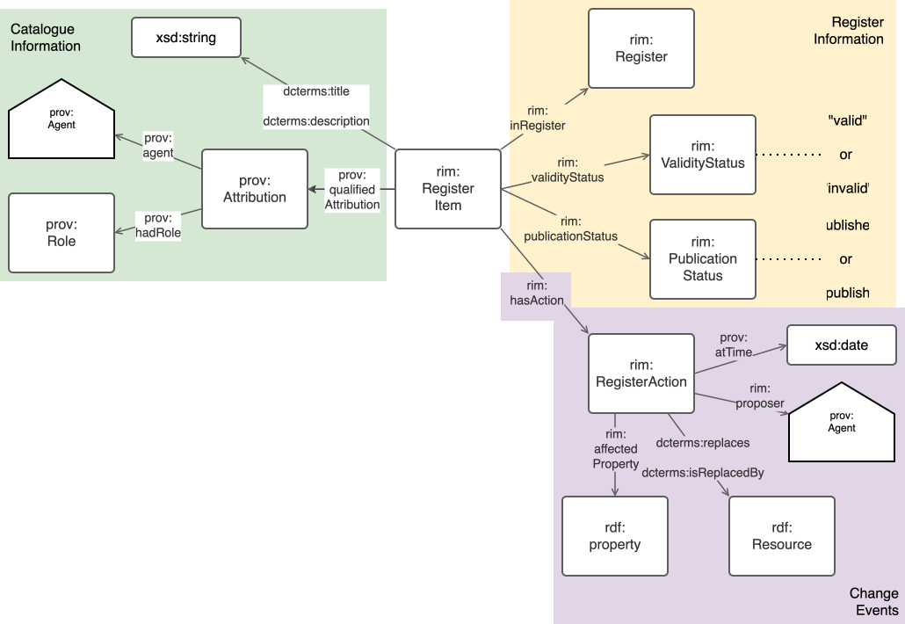

# Registered Item Model — core ontology

This block defines the **ontology** (`ontology.ttl`, split for maintenance into `owl.ttl` and
`skos.ttl`) and **SHACL shapes** (`shapes.shacl`) for the base Registered Item Model: an RDF model
for register items, register item classes and register governance metadata, based on
[ISO 19135:2026](https://www.iso.org/standard/86261.html).

## What it covers

- **Content model** — `rim:RegisterItemClass` and `rim:RegisterItem`, the unit rules attach to and
  the concrete records that carry them.
- **Concept plane** — `rim:Concept`, `rim:ConceptVersion` and `rim:ConceptSystem`, for registers
  that separate meaning from representation (reuses SKOS directly).
- **Management metadata** — object/functional identifiers, validity/publication status (the
  required core), optional redaction/deletion flags, extensible relations (e.g.
  `rim:supersededBy`), and recorded `rim:RegisterAction`s with their change classification.
- **Governance roles** — the six ISO 19135:2026 roles (owner, manager, control body, proposer,
  system manager, user), modelled as direct properties onto `prov:Agent` so any register's own
  "maintainer"/"editor"/"submitted by" fields map onto one shared vocabulary.
- **Commitments** — the access / persistence / transparency promise layer a register makes to its
  users.

## Purpose

A register differs from a plain dataset or database in being governed through defined processes.
Most registers already have *some* schema for their content; what they lack is a common vocabulary
for the governance and lifecycle metadata that makes them a register rather than just a catalogue.
This block gives every register — regardless of its own native schema — a single JSON-LD context
target for that metadata, so item classes, identifiers, statuses, actions and roles from otherwise
unrelated registers become one queryable graph.

**Register vs. registry:** the register is this governed information; the *register system*
(often loosely called the "registry") is only the information system it happens to run on —
`rim:RegisterSystem` is deliberately a separate, lightly-specified class so that migrating a
register to new infrastructure is not a change to the register itself.

Sub-registers are expected to declare `isProfileOf` this block — as a null profile (no new
elements, only tighter constraints on who may publish or which values are allowed), an additive
profile (new item classes or properties), or a constrained profile (narrower cardinalities or
enumerations) — and always validate against this base model.

## Register Item Class

